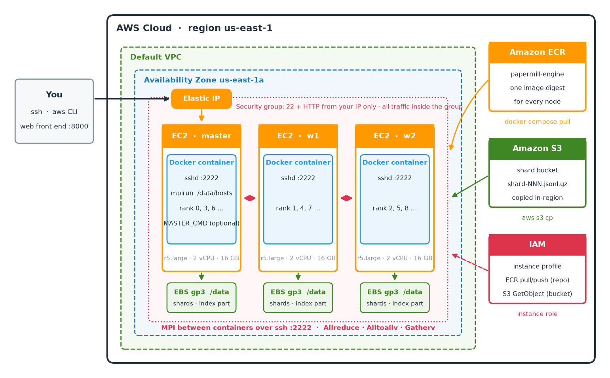
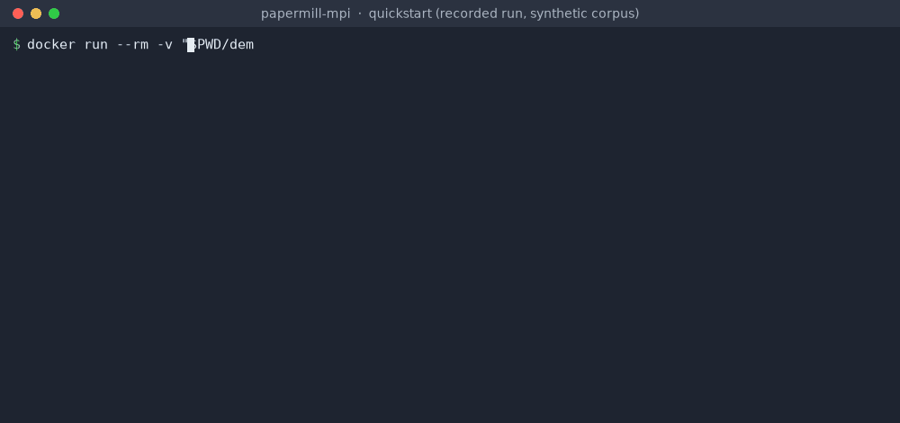
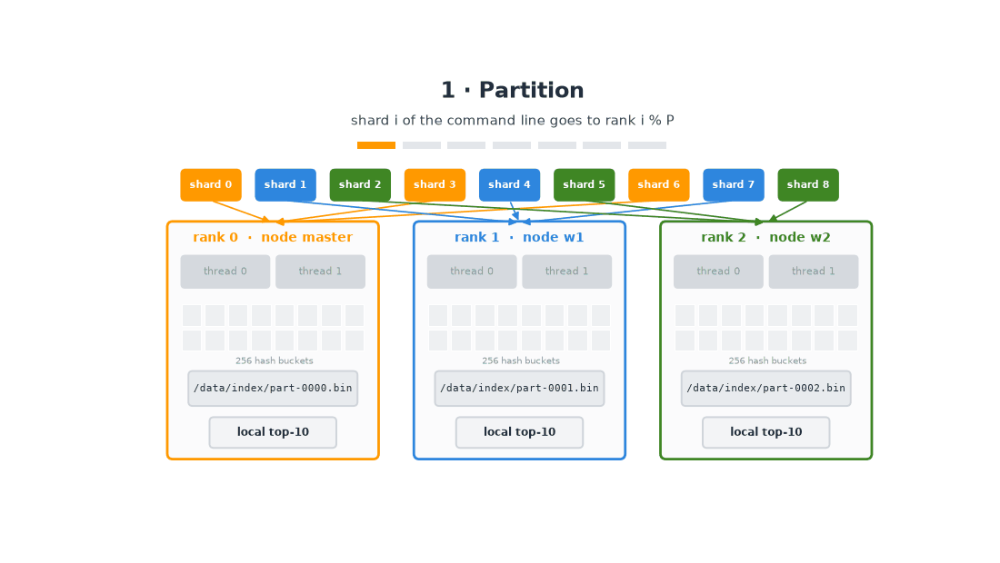
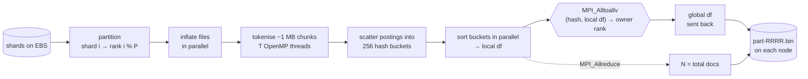
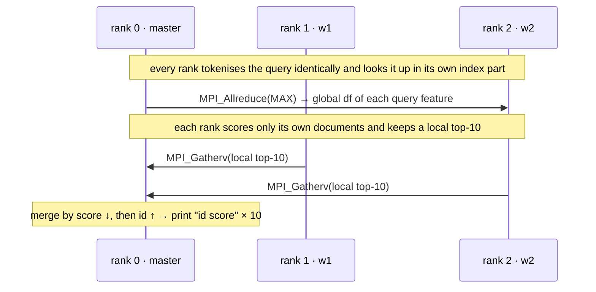

<div align="center">

# papermill-mpi

**Distributed TF-IDF search over ~2.5M arXiv papers, on a 3-node AWS cluster.**<br>
One C++17 binary · three execution modes · the same answer on every layout.




</div>

## At a glance

| | |
|---|---|
| **Data** | 200 gzip JSONL shards of arXiv titles + abstracts, ~12.6K papers each (~2.5M papers) |
| **Index** | TF-IDF over **unigrams + bigrams**, 64-bit hashed features, 12-byte postings, one index part per node |
| **Modes** | sequential · OpenMP (T threads) · MPI + OpenMP (P ranks × T threads over 3 nodes) |
| **Guarantee** | byte-identical top-10 for every threads × ranks × passes combination, checked against a Python reference |
| **Cloud** | EC2 ×3, EBS gp3, Elastic IP, ECR (one image digest), S3 (shards), IAM instance profile, security group |
| **Ops** | `docker compose` per node, `restart: unless-stopped`, scripted deploy / stop / start / cleanup |

<div align="center">

<br><sub>Replay of a recorded run (synthetic corpus): 1 process, then 3 MPI ranks × 2 threads, same results.</sub>
</div>

## Contents

[Architecture on AWS](#architecture-on-aws) · [How a run works](#how-a-run-works) · [Under the hood](#under-the-hood) ·
[Quickstart](#quickstart-local-docker) · [Deploy on AWS](#deploy-on-aws) · [Benchmarks](#benchmarks) ·
[Configuration](#configuration) · [Testing](#testing) · [Design decisions](#design-decisions--lessons-learned) ·
[Repository layout](#repository-layout)

## Architecture on AWS

The whole system runs on AWS and is created by the scripts in [`aws/`](aws/). Every resource is tagged
`Project=$PROJECT`, so `cleanup.sh` can find and delete all of it.

| AWS service | What it does here |
|---|---|
| **EC2** ×3 | `master`, `w1`, `w2`: identical non-burstable nodes (r5.large: 2 vCPU, 16 GB) in **one AZ** for low MPI latency |
| **Docker on each node** | one container per node from the same image; `network_mode: host`, sshd on **:2222** for MPI, key login only |
| **Amazon ECR** | holds the image; every node pulls **the same digest**, so OpenMPI and the binary match everywhere |
| **Amazon S3** | the shard bucket; shards are copied to each node **in-region** (fast, no transfer cost) |
| **EBS gp3** | `/data` on every node: settings, shards, and that node's index parts |
| **Elastic IP** | a fixed address for the master that survives stop/start |
| **Security group** | ssh and HTTP from your IP only; **all traffic inside the group** carries MPI and ssh between nodes |
| **IAM instance profile** | nodes pull from ECR and read the shard bucket without storing any credentials |

Running cost with 3 × r5.large in us-east-1: about **$0.41/h** (instances $0.378, gp3 $0.016, public IPv4 $0.015);
stopped, about **$0.02/h** (disks + Elastic IP). `./stop.sh` and `./start.sh` switch between the two, and the
containers come back by themselves after a start.

## How a run works

<div align="center">

</div>

**Index** (`engine index <shards…>`):



**Search** (`engine search "<query>"`, same ranks as the index):



## Under the hood

<details open>
<summary><b>Tokenisation and scoring</b></summary>

Documents and queries go through the same pipeline, configured at run time by `settings.txt`:

1. lower-case; a token is a maximal run of `[a-z0-9]` (JSON escapes and UTF-8 are decoded in place; non-ASCII splits
   tokens, except the two code points whose Python `lower()` is ASCII)
2. drop tokens shorter than `min_token_len`, then stoplist words (compared before stemming)
3. `plural_s`: a token longer than 3 characters ending in `s` but not `ss` loses the `s`
4. features = unigrams + bigrams of consecutive surviving tokens (`graph_neural`), so a bigram can span a removed stopword

Weight = tf × idf, optionally L2-normalised. Query weight = count × idf over features that exist (df > 0),
L2-normalised; score = dot product; at most 10 results with score > 0.

| tf | idf | norm |
|---|---|---|
| `raw` c · `log` 1 + ln c · `aug` 0.5 + 0.5 c / max c | `plain` ln N/df · `smooth` ln((1+N)/(1+df)) + 1 · `bm25` ln(1 + (N−df+0.5)/(df+0.5)) | `none` · `l2` |
</details>

<details>
<summary><b>64-bit feature hashing, and proving it is safe</b></summary>

A feature is identified by the 64-bit hash of its text (FNV-1a + splitmix64 finaliser). A bigram hashes the
string `a_b`, which no unigram can equal, because unigrams never contain `_`. Nothing stores or copies feature strings.
`engine collisions K` re-reads the corpus, keeps the real text beside every hash in K hash-range passes, and
reports any hash that maps to two different texts. Results are in [Benchmarks](#benchmarks).
</details>

<details>
<summary><b>Compact postings and the multi-pass low-memory mode</b></summary>

Each parser thread scatters its postings into 256 buckets by the top 8 hash bits, so threads never share a lock;
the buckets are then sorted in parallel. A posting is **12 bytes**: the hash plus one 32-bit word
(`doc << 8 | count`). Counts ≥ 255 go to a small sorted side table.

If a rank's postings would not fit in RAM (estimated from input size against `MemAvailable` and the ranks on the
node), it indexes the hash range in several passes and streams each pass's postings straight into the index file.
The output is byte-identical for any number of passes.
</details>

<details>
<summary><b>Hash-partitioned global df</b></summary>

N comes from `MPI_Allreduce`. Every feature has an **owner rank** (`hash % P`). Each rank sends
`(hash, local df)` for all of its features to the owners with `MPI_Alltoallv`. Owners k-way-merge the P sorted
runs, add the counts, and reply with the global df in the same order through a second `Alltoallv`. No rank ever
holds the whole vocabulary.
</details>

<details>
<summary><b>Distributed top-k with deterministic ties</b></summary>

Ranks agree on the query's df values with `MPI_Allreduce(MAX)` (only ranks that hold a feature know its df), score
their own documents from the memory-mapped index part, and keep a local top-10. Rank 0 merges the
`MPI_Gatherv` result by score descending, then id ascending. All sums run in a fixed order: query features in hash
order, and L2 lengths over value-sorted weights. So exactly equal scores stay bit-equal, and ties resolve the same
way on every layout.
</details>

## Quickstart (local Docker)

```bash
docker build -t papermill-mpi .
python3 tests/gen_corpus.py demo && cp examples/settings.example.txt demo/settings.txt   # synthetic corpus

docker run --rm -v "$PWD/demo:/data" papermill-mpi /opt/engine index 0 1 2 3
docker run --rm -v "$PWD/demo:/data" papermill-mpi /opt/engine search "qxbravo qxalpha"

# 3 MPI ranks × 2 threads inside one container (a search must use the same -np as its index)
docker run --rm -v "$PWD/demo:/data" -e OMP_NUM_THREADS=2 papermill-mpi \
  mpirun --oversubscribe -np 3 -x OMP_NUM_THREADS /opt/engine index 0 1 2 3
docker run --rm -v "$PWD/demo:/data" papermill-mpi mpirun --oversubscribe -np 3 /opt/engine search "qxbravo qxalpha"
```

An index run prints progress (`0` … `100`, one number per line) on stdout and a timing summary on stderr.

## Deploy on AWS

**Prerequisites:** AWS CLI v2 configured, a vCPU quota of at least 6 for standard on-demand instances in the region,
and your shards in an S3 bucket as `shard-NNN.jsonl.gz`.

```bash
cp aws/config.env.example aws/config.env   # region, AZ, instance type, shard bucket + list, DATA_SRC
```

| Step | Command | What happens |
|---|---|---|
| 1 | `bash aws/01_infra.sh` | key pair, security group, IAM role + instance profile, ECR repository |
| 2 | `bash aws/02_launch.sh` | 3 nodes from Ubuntu 22.04 with Docker via user-data, Elastic IP on the master |
| 3 | `bash aws/05_build.sh` | builds the image **on the master** (native amd64, next to ECR), pushes it, records the digest |
| 4 | `bash aws/04_deploy.sh` | data files (sha256-checked), shards from S3, shared mpiuser key, `compose up`, `/data/hosts` |
| 5 | `bash aws/07_run.sh 3 2 index 0 1 2 3` | index with 3 ranks (one per node) × 2 threads |
| 6 | `bash aws/07_run.sh 3 2 search "dark matter halo"` | top-10 from the cluster |
| ops | `./stop.sh` · `./start.sh` · `bash aws/06_redeploy.sh` · `bash aws/03_resize.sh TYPE` | stop/start · roll a new digest · resize in place |
| end | `./cleanup.sh` | lists everything it would delete, then asks for `yes` |

## Benchmarks

Wall time per index run, measured by an external front end; every node has 2 vCPUs (1 physical core + HT).

| Corpus | Nodes | Sequential | OpenMP T=2 | MPI 3 × 2 | Notes |
|---|---|---|---|---|---|
| 1 shard (12,470 papers) + 2,000 sentinel docs | 3 × r5.large | 0.797 s | 0.656 s | 1.100 s | start-up dominates at this size |
| 20 shards (N = 253,763) | m7i-flex.large | 8.706 s | coming soon | coming soon | 36.7M postings, 7.0M features, peak RSS 928 MiB |
| 200 shards (~2.5M papers) | 3 × r5.large | coming soon | coming soon | coming soon | |

| Exact collision check | Distinct features | Collisions |
|---|---|---|
| 2 shards + 2,000 sentinel docs | 1,293,020 | **0** |
| synthetic test corpus | 181,416 | **0** |
| 200 shards | coming soon | coming soon |

## Configuration

`settings.txt` (see [`examples/settings.example.txt`](examples/settings.example.txt)): `tf`, `idf`, `norm`,
`min_token_len`, `stemming` (`plural_s` | `none`), `stoplist` (comma-separated). Input lines are JSON objects
`{"id": "...", "text": "..."}` in any key order.

| Variable | Default | Meaning |
|---|---|---|
| `PAPERMILL_DATA` | `/data` | data root |
| `PAPERMILL_SETTINGS` | `$PAPERMILL_DATA/settings.txt` | settings file |
| `PAPERMILL_SHARD_PATTERN` | `shards/shard-%03d.jsonl.gz` | shard number → file (relative to the root unless absolute) |
| `PAPERMILL_EXTRA` | `$PAPERMILL_DATA/extra.jsonl` if present | extra documents read on every index run (empty = none) |
| `PAPERMILL_INDEX` | `$PAPERMILL_DATA/index` | per-node index directory |
| `PAPERMILL_PASSES` | automatic | force the number of hash-range passes |
| `OMP_NUM_THREADS` | all cores | threads per rank |
| `ROLE`, `MASTER_CMD`, `MPIRUN_ARGS` | `worker`, –, – | container role, optional master service, extra `mpirun` flags |

## Testing

[`reference.py`](reference.py) is a deliberately simple Python implementation (string dictionaries, no hashing) used
as the oracle. [`tests/run_tests.sh`](tests/run_tests.sh) runs inside the image and requires every case to match the
reference at 1e-6 relative tolerance **and** to be byte-identical across layouts:

- a worked toy example with an exact tie broken by id
- hand-written edge cases (`uses`→`use`, `papers`/`paper`, `ss` endings, bigrams across stopwords, JSON escapes,
  non-ASCII, counts ≥ 255, all-stopword and unknown-word queries) under **three settings files that cover every
  tf / idf / norm option**
- a synthetic corpus ([`tests/gen_corpus.py`](tests/gen_corpus.py)) with and without gzip shards
- layouts 1×1, 1×4, 3 ranks × 2 threads, plus forced 2- and 3-pass runs
- a 1-rank search must refuse a 3-rank index; the exact collision check must report 0

```bash
docker run --rm -v "$PWD":/work:ro papermill-mpi bash /work/tests/run_tests.sh   # → ALL TESTS PASSED
```

## Design decisions & lessons learned

- **Determinism is designed in.** Exactly equal scores drifted apart in the last bit once L2 lengths were summed
  in hash order. Summing value-sorted weights made ties exact again on every layout.
- **Hash, then verify.** 64-bit feature hashes cut memory and remove string copies; a separate exact collision
  check measures the risk instead of assuming it away.
- **Memory first.** 12-byte postings and the multi-pass mode were added after a 20-shard run (928 MiB peak)
  projected about 7 GiB for a sequential full-corpus run, too close to an 8 GB node. The full-corpus measurement
  is coming soon.
- **One image digest everywhere.** MPI needs the same OpenMPI and the same binary on every node. Building on the
  master, next to ECR, avoids pushing hundreds of MB over a slow uplink.
- **`mpirun` forwards stdin to rank 0.** Inside a `while read` loop it silently eats the rest of the input, so give
  it `< /dev/null`.
- **OpenMPI adds OS threads.** A singleton (no `mpirun`) forks an `orted` and keeps two runtime threads. The engine
  requests an isolated singleton (`ess_singleton_isolated`), which leaves one progress thread that is compiled
  into Ubuntu's OpenMPI 4.1.
- **Pin MPI to the VPC interface** (`btl_tcp_if_include` / `oob_tcp_if_include`) when containers use host
  networking, or OpenMPI may try the `docker0` bridge.

## Repository layout

```
engine/      common.hpp settings.hpp tokenize.hpp io.hpp engine.cpp   C++17 engine (MPI + OpenMP)
docker/      entrypoint.sh sshd_config ssh_client.conf                node image runtime
aws/         01_infra … 07_run, lib.sh, config.env.example            provisioning, deploy, cluster runs
tests/       run_tests.sh gen_corpus.py compare.py toy/ unit/          cross-layout test suite
docs/        aws-architecture.png pipeline.gif demo.gif make_figures.py   README figures (regenerable)
examples/    settings.example.txt queries.txt
reference.py Dockerfile docker-compose.yml start.sh stop.sh cleanup.sh
```

## License

[MIT](LICENSE) © saadhtiwana
